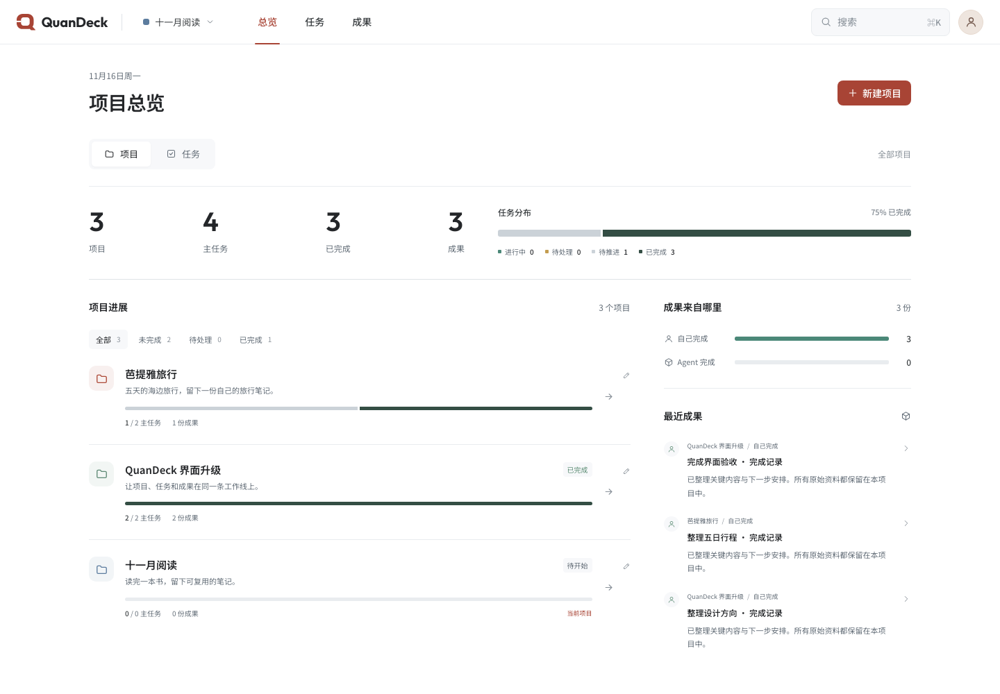

# QuanDeck

把想法整理成方法，把方法拆成任务，让执行过程与成果留在同一个地方。



## 安装

从 [Releases](https://github.com/Johnie198946/QuanDeck/releases) 下载对应版本：

- **macOS Apple Silicon**：打开 `.dmg`，将 QuanDeck 拖到 Applications。
- **Windows x64**：运行 `Setup.exe`，按向导安装；支持开始菜单入口与卸载。

当前安装包未使用商业代码签名证书；macOS 使用 ad-hoc 签名。下载后可通过 Release 中的 SHA256 文件核对完整性。

## 使用

1. 新建项目，在项目中记录任务。首次安装没有示例项目、任务或 Agent。
2. 普通任务可以直接执行；复杂项目先打开“项目方向”，确定目标、执行逻辑、任务拆分和最终交付清单。任务也有自己的方向方案。
3. 确认方向并开启自动推进后，后端按依赖执行任务与子任务，逐件接收候选成果并自动整合；缺少内容的位置保持空白。
4. 项目成果地图展示最终交付，任务及子任务的成果地图展示各自贡献。候选、已验收和正式发布分别记录，最终发布前核对每件内容及来源。
5. 项目管理中的“项目记忆”提供背景、已定结论、任务总结与下一步；新任务自动获得本项目的规范和必要交接，不读取执行流水作为业务记忆。

“删除项目”会在一次原生确认后清除该项目的本机数据。“归档项目”是独立可选项，可从项目列表的“已归档项目”恢复。共享 Agent 配置、其他项目和用户工作目录原文件不随目标项目删除。详见[项目管理与记忆规则](docs/project-lifecycle-memory-v0.17.md)。

创建任务时可上传附件，也可在任务或子任务详情中补充、下载和移除。每个任务最多 20 个附件，每个文件不超过 25 MB；新派发的 Agent 会收到对应文件。待安排和任务列表的标题最多显示两行，智能输入会归纳短标题；已有长标题可点击“AI 精简标题”，完整原文仍保留。

任务与子任务拥有固定图标：项目内形状不重复，主任务与所有后代共用任务族颜色。100 种基础形状与 8 套配色覆盖任务、成果、日程和搜索，超过 100 项自动扩展；改名、排序、归档和重启保留身份。参见 [任务图标规则](docs/task-icons.md) 与 [100 种图标预览](docs/images/task-icons.png)。

“总览”可切换项目与任务维度：项目进度、待处理状态、成果贡献，以及单个项目的任务状态和日程。顶部切换项目，右上角头像打开设置与本地 Agent 配置。

桌面版的项目、方法、任务、会话、连接配置和附件由本地进程写入磁盘，不需要部署服务器。桌面版使用 SQLite 事务保存当前状态与不可变历史索引；附件单文件不超过 25 MB。升级时读取旧版真实项目，旧演示数据不会导入。网页版开发预览仍使用浏览器本地存储。设置中可导出项目 JSON、下载成果附件和清理旧安装包。

Codex 使用 App Server，Claude Code 使用官方 Agent SDK，DeepSeek Harness 使用官方 `dsh sdk` 协议：支持真实派发、进度、Token、末轮回复、子 Agent、权限处理及暂停/续聊。桌面版自动配对本地服务；在设置中选择 CLI 程序和项目目录即可测试连接，DSH 的模型与账号沿用源工具的 SDK 配置，无需在工作台填写 Provider 或 Model ID。测试连接会在后台完成一次 hello 收发，界面只显示是否连通；已保存的 Agent 可重新测试。具体步骤见 [带截图的配置教程](docs/local-agent-setup.md)。

“查看源会话”直接打开源 Agent，任务方法汇总结论。Codex 与 Claude Code 打开原会话；DSH 打开自己的界面，当前 SDK 无法精确定位时会提示。分析采用后可以继续拆成任务；每轮结束不会自动把任务标为完成，成果验收时检查人工和 Agent 子任务，归档保留历史而不代表验收通过。重启恢复记录到暂停，用户继续后才发起下一轮。

本地 Agent 可以保存多个独立命名配置。任务派发前检查连接，运行异常和长时间无进展从右上角铃铛查看；程序握手不能证明模型或余额可用。配置有序备用并明确启用后，只有任务尚未发送时可自动换用；执行中需要预览并确认交接，原进程停止后创建新执行，保留原成果、用量和来源。后台输入分析、项目摘要与成果 AI 复核的失败仍在各自页面显示，不自动换用另一个账户。

每日安排跨项目显示任务、计划和真实投入；新待办插在首行。原生日程、菜单栏/托盘、任务和成果都读取同一份本地业务状态。各工具的实测覆盖和仍待验证项见 [PRD 验收矩阵](docs/PRD-LOCAL-RUNTIME-ACCEPTANCE.md)。

## 多个任务需要一起决定一件事时

在「帮你管」打开项目总览或相关任务的「共同决定」。两段行程都涉及京都住宿时，点「核对范围」，填上同行旅客和具体入住日期。两边可以继续调查，分别提交备选方案。选定酒店时记录理由，关联任务会引用这个选择。更换酒店后，先核对引用旧选择的成果再交付。也可以用「关联任务」手动建立共同决定。

把项目连接到 Git 仓库根目录后，受管的写入任务在自己的分支和工作树中执行。开始新任务前，请先把需要带入的源码修改保存为本地提交。重试会回到原任务的工作树。功能任务交付改动和验证结果，发布任务统一核对最新基线与版本。

## 本地开发

使用 Node 22.15+ 与 pnpm 10：

```sh
pnpm install --frozen-lockfile
pnpm dev --host 127.0.0.1 --port 4173
```

可选：另一个终端运行 `pnpm bridge`，在设置中填入本地地址与终端显示的配对码。配置业务后端时复制 `.env.example` 为 `.env.local` 并设置 `VITE_WORKDECK_API`；这些是网页版集成选项；安装桌面版无需另行部署，应用内置业务核心与本地连接服务。

```sh
pnpm exec tsc --noEmit
pnpm test
pnpm build
```

## 构建安装包

```sh
pnpm desktop:setup
pnpm desktop:mac
pnpm desktop:windows
```

桌面构建和原生安装验证流程见 [桌面版说明](desktop/README.md)。安装包由 GitHub Actions 在对应操作系统构建。

## 源码与接口

| 路径 | 内容 |
| --- | --- |
| `src/components/results` | 成果册、任务地图、方法与结果详情 |
| `src/components/projects` | 项目选择、新建与设置 |
| `src/components/outputs` | 人工成果编辑、草稿与附件 |
| `src/data` | 任务模型、搜索、统计、时间线与数据源 |
| `src/integration` | Agent 连接与回源契约 |
| `scripts/agent-bridge.mjs` / `scripts/runtime` | 真实工具检测、连接、运行与会话发现 |
| `desktop/app/local-store.mjs` | 本地磁盘数据与附件 |
| `src/data/runtimeDataSource.ts` | 执行事件到任务、结论、成果和时间线的映射 |
| `desktop` | Electron 桌面应用与安装包 |
| `docs` | 产品设计和后端接入说明 |

- [成果整合、来源追溯与任务记忆](docs/result-integration-prd.md)
- [项目记忆设计与实现](docs/project-memory-design.md)
- [产品边界简报](docs/product-boundary-report.md)
- [连接检测、异常提醒与备用接管](docs/agent-reliability-prd.md)
- [后端交接](docs/backend-handoff.md)
- [项目与人工成果](docs/projects-and-outputs.md)
- [搜索与执行汇总](docs/search-activity-contract.md)
- [执行事件与全天时间线](docs/timeline-adapter-contract.md)
- [Agent 连接接口](src/integration/README.md)

本项目基于用户提供的 Figma Make 前端持续开发。第三方工具名称及标识属于各自权利人。
