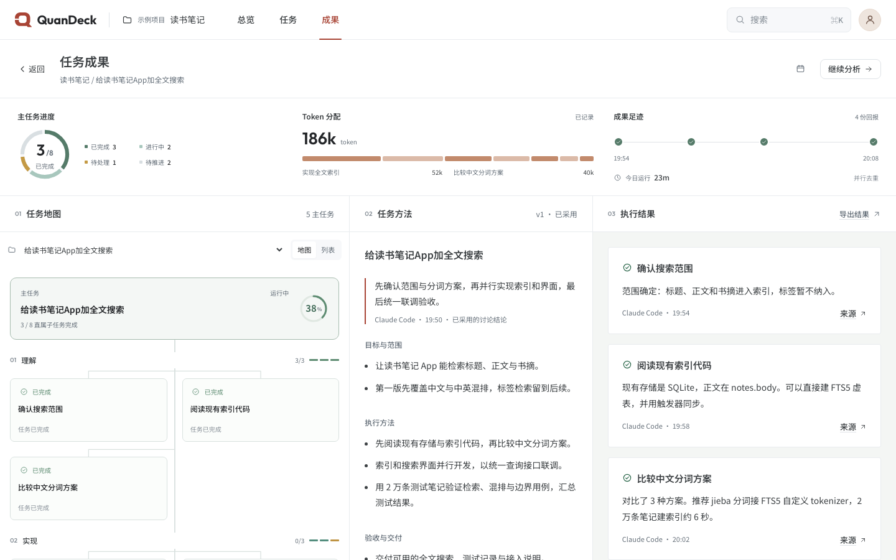

# QuanDeck

把想法整理成方法，把方法拆成任务，让执行过程与成果留在同一个地方。



## 安装

从 [Releases](https://github.com/Johnie198946/QuanDeck/releases) 下载对应版本：

- **macOS Apple Silicon**：打开 `.dmg`，将 QuanDeck 拖到 Applications。
- **Windows x64**：运行 `Setup.exe`，按向导安装；支持开始菜单入口与卸载。

当前安装包未使用商业代码签名证书；macOS 使用 ad-hoc 签名。下载后可通过 Release 中的 SHA256 文件核对完整性。

## 使用

1. 在“任务”记录一句想法，选择 Agent 进行讨论。
2. 将讨论结论带回，采用到方法，整理为主任务与子任务。
3. 分配给自己或已配置的 Agent，安排日程并查看执行进度。
4. 在“成果”打开任务地图，逐层查看任务、方法、完成回报与用量。

“总览”汇总任务状态和日程；右上角头像打开设置与本地 Agent 配置。

当前默认是示例项目。已提供本地工具检测、连接测试、Codex 元数据读取与回源能力；完整真实任务派发、业务数据同步与讨论自动回流仍需业务后端。讨论可通过复制指令、在源 Agent 沟通、手动带回结论完成，复制动作不会标为派发成功。

## 本地开发

使用 Node 22.15+ 与 pnpm 10：

```sh
pnpm install --frozen-lockfile
pnpm dev --host 127.0.0.1 --port 4173
```

可选：另一个终端运行 `pnpm bridge`，在设置中填入本地地址与终端显示的配对码。配置业务后端时复制 `.env.example` 为 `.env.local` 并设置 `VITE_WORKDECK_API`；业务后端与连接服务是两个独立服务。

```sh
pnpm exec tsc --noEmit
pnpm test
pnpm build
```

## 构建安装包

```sh
pnpm desktop:setup
pnpm desktop:mac
pnpm desktop:windows
```

桌面构建和原生安装验证流程见 [桌面版说明](desktop/README.md)。安装包由 GitHub Actions 在对应操作系统构建。

## 源码与接口

| 路径 | 内容 |
| --- | --- |
| `src/components/results` | 成果册、任务地图、方法与结果详情 |
| `src/data` | 任务模型、搜索、统计、时间线与数据源 |
| `src/integration` | Agent 连接与回源契约 |
| `scripts/agent-bridge.mjs` | 本地连接服务 |
| `desktop` | Electron 桌面应用与安装包 |
| `docs` | 产品设计和后端接入说明 |

- [后端交接](docs/backend-handoff.md)
- [搜索与执行汇总](docs/search-activity-contract.md)
- [执行事件与全天时间线](docs/timeline-adapter-contract.md)
- [Agent 连接接口](src/integration/README.md)

本项目基于用户提供的 Figma Make 前端持续开发。第三方工具名称及标识属于各自权利人。
