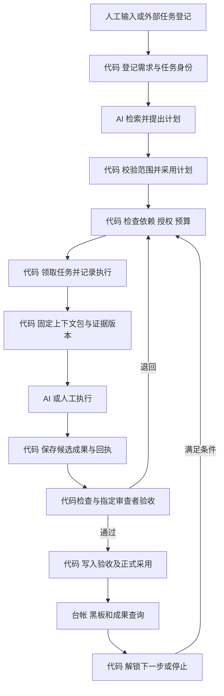

# QuanDeck 工作流与事务边界

本文中的 task、run、session 使用主设计与 agent-protocol.md 的语义。示例使用泰国旅行作为测试夹具，不构成真实班次、价格或预订建议。

## 1 全流程职责图

图中的“代码”是确定性业务服务；“AI”是被调用的规划/执行能力。验收可以包括AI语义评估，但是否接受由预先设定的验收政策及可信reviewer身份决定。

## 2 首次创建项目 台帐与黑板

| 步骤 | 输入与处理 | 持久化 | 失败后行为 |
| --- | --- | --- | --- |
| 用户创建项目 | name、objective、timezone及初始政策 | 命令服务生成project_id | 缺必要输入返回字段错误 |
| 事务A | CreateProject幂等与权限验证 | project、初始policy、ProjectCreated、receipt | 全部回滚；重试不重复创建 |
| 初次查询 | 按project_id查询ledger与blackboard | 可无缓存，直接读同库 | 返回空任务、空阻塞，不能伪造演示工作 |
| 导出 | 生成PROJECT/LEDGER/BLACKBOARD | 导出文件及source_seq | 导出失败可重试，不改变业务成功结果 |
| 可选AI介绍 | 用户需要规划时才请求 | 保存候选proposal | 模型不可用时仍可人工加任务 |

台帐与黑板从项目创建起就有可查询地址，不需要AI先写一段文本才能“存在”。全部事实为空时显示为空。

## 3 需求转计划和任务

用户输入先作为原始材料登记，保存message_id、actor、时间和项目归属。需要AI规划时，代码创建或复用一项范围明确的规划Task，交付物为“候选计划与缺口清单”，按同一权限与预算流程启动purpose=discussion的Run并构建上下文。Planner读取当前项目说明、相关已验收成果索引和本次输入，生成绑定该Task/Run的plan_proposal。这样规划本身也可计量、暂停、重试和交接，不存在无身份的幕后AI调用。

proposal中的任务临时key只用于这个候选计划；正式采用时由代码生成稳定task_id，保存proposal-key到task-id映射。不要让模型指定数据库主键或冒充已经存在的任务。

采用流程：
1. 校验proposal结构与引用。
2. 将新任务、现有任务引用、修订建议分别展示/计算。
3. 验证每个新任务有目标、交付物、验收条件、owner、执行类型与范围。
4. 检查依赖图无环、没有跨项目越权引用、没有无限重复拆分。
5. 确认属于既有授权或取得缺失授权。已经授权的普通拆分可以按政策自动采用。
6. 在一个事务中落下任务和requirements版本、依赖、决定、事件和回执。
7. 代码计算ready或blocked，不把AI自报的“可执行”直接写入。
8. 通知黑板就绪队列更新，按容量派发。

同一个proposal采用三次仍只创建一组任务。修改proposal内容形成新proposal版本/新采用请求，不能复用同一个幂等键覆盖原采用。

“先不执行，只帮我讨论方法”允许上述规划Task的discussion Run调用AI并记录成本，只产生候选计划，不触发计划内执行子任务。用户采纳方法也不必等于授权所有外部动作，政策分别判断。

## 4 AI任务的领取 上下文与派发

上下文构建和外部工具调用可能很慢，不放在SQLite写事务里。

事务B：领取与预留
- 根据任务当前version、ready状态及依赖决定是否可领取。
- 检查授权、adapter能力、并发容量和预算。
- 增加claim_epoch，分配run_id和内部session_id，预留预算。
- 将task.active_run绑定本Run，任务转running并递增业务version。
- Run先为queued，写入PrepareRun outbox与事件、回执后提交。

事务B之后：构建上下文
- 获取本Run绑定的spec_revision、policy_version及相关成果版本。
- 装配L0/L1/L2材料；按实际模型预算检查，记录不足或省略项。
- 将完整context package保存为不可变版本及hash。
- 此时provider的源会话可能尚未创建；internal session_id已经固定，provider source ID稍后映射。
- sessions.source_session_id在origin=dispatch的准备阶段允许NULL；observed/import必须有真实源ID。受理后适配器补齐，不生成假的provider ID。
- 若必须条件超出预算，Run等待处理，释放不需要的资源；不能静默裁剪硬条件。

事务C：允许派发
- 再次检查task仍绑定此Run、claim_epoch有效、spec/policy仍适用。
- 绑定context_package_id，创建带dispatch_key的DispatchRun outbox，提交。
- 若期间用户改了要求，废弃此包的派发资格，保留构建记录，重新构建或阻塞。

事务C之后：适配器派发
- dispatcher读取outbox，发起新会话或已明确允许的续聊。
- 网关只授予本Run能力和期限，模型输出进入受绑定通道。
- 回执保存provider_run_id、source_session_id、受理状态及真实开始时间。
- outbox重复投递时复用同一dispatch_key；无幂等/查询能力时进入unknown并核对，不盲目重复启动。
- 只有adapter真实受理后显示“已受理/运行”，不能因为outbox入队就显示agent已经开始。

领取参考伪代码（设计逻辑，非已实现函数）：

    begin immediate
      receipt = findReceipt(actor, idempotencyKey)
      if receipt exists:
        require same requestHash
        return receipt
      task = readTask(project, taskId)
      require task.version == expectedVersion
      require task.state == ready
      require dependenciesSatisfied(task)
      require noUnresolvedExternalActions(task)
      require policyAllows(task, executor)
      reserveBudget(project, proposedRun)
      update task using version compare-and-swap
      insert run, event, PrepareRun outbox, receipt
    commit
    return receipt

预算预留和任务领取必须在同一事务/锁边界内，否则两个任务可以各自看到相同剩余额度而同时超支。

## 5 执行中事件与检查点

adapter事件先写入入站记录，按provider、connection、source_run、event_id唯一去重。事件序号只在明确的源流内比较；不能以不同机器的时间戳判断业务新旧。

有seq缺口时保存已收到事件并请求补齐/源端核对。没有可靠seq的provider使用adapter持久化入站序列和源事件ID，不伪造源端完整性证明。公共reply、usage、permission、state、structured_submission分开处理。

心跳只更新Run存活信息。模型checkpoint可以保存：
- 已完成与剩余步骤。
- 工作文件/成果版本引用。
- 未解决问题。
- 已经执行或结果不确定的外部动作ID。
- 继续执行所需的最小说明。

代码保存检查点时验证路径或文件ID是否属于当前Run允许范围。一个普通检查点不能把Task设置done，也不能把AI自述的“已经付款”作为外部成功回执。

用户在执行中修改要求：
- 普通不影响交付的注释不改变spec_revision。
- 改目标/硬约束/验收条件产生新spec_revision，触发影响检查。
- 旧运行可暂停或仅允许保留草稿；旧结果不能自动验收为新要求完成。
- 尽可能复用仍有效的产物，不要求一律重做全部研究。
- 预算、scope或权限变严格后工具调用立即用当前授权校验，不能因旧context里写过允许就继续。

## 6 提交结果和验收

result submission示例见 examples/result.valid.json。结构校验只确认格式，不确认真实性。

落盘过程：
1. 附件先完成临时上传、hash校验、原子rename；生成受限blob引用。
2. 身份绑定与schema校验通过。
3. 校验幂等、task_version、spec_revision、claim_epoch、当前run、policy和所有引用。
4. 单事务新增submission、artifact version、来源边、Task进入in_review、Run结束原因、事件与回执。
5. 触发验收任务，不能同时自动写task.done。
6. 结果陈旧或存在版本冲突时保留原运行材料，回执说明需要重新核对。修正请求使用新幂等键，不能自动替换expected_version掩盖冲突。

验收分三层：
- 结构检查：成果存在、字段完整、引用可访问、hash符合。
- 确定性检查：代码测试、文件格式、必需来源、时间/预算/约束规则。
- 语义检查：内容是否真正满足目标、证据是否支持结论。由指定人工或独立reviewer完成，并记录rubric版本。

自动验收政策可以允许低风险、确定性检查足够的任务无需人点按钮。复杂研究使用AI reviewer只是语义检查输入，不能证明绝对正确；重要条件由明确的人工决策或可核验证据支持。不能让提交者通过自报pass直接担任其自己的验收政策。

需要AI复核时，创建独立review Task并启动purpose=review的Run，引用待审submission；它提交advisory成果，不抢产出Task的active_run/claim_epoch。人工ReviewSubmission无需Run。验收原成果验证“提交当时来源合法，当前要求与证据仍适用”，不要求已经结束的产出Run继续保有活租约。复核任务的产物是审查意见，由ReviewService按验收政策消费，禁止为每份审查意见无限创建新的AI复核任务。

review Task在target_submission合法保存后即可就绪，不等待产出Task done。它是同项目的独立复核任务，通过review_target_submission引用目标，不添加“原任务done”阻塞边，避免双方互等。复核任务本身按预设报告完整性政策完成，不意味着被审成果被接受。reviews.run_id如果填写表示产出提交的Run；独立复核Run由evidence_json的reviewer_run_id与advisory成果引用记录并由服务验证，不能填入要求同Task外键的run_id列。

事务D：接受成果
- 验证reviewer身份与authority。
- 对比review所针对的artifact/spec/policy与当前版本。
- 确认必需检查通过，关键来源仍适用，必需子任务已完成或有明确范围豁免。
- 写入不可覆盖review，设置当前采用成果指针，Task done；预算结算/释放依据已核对用量。
- 写TaskAccepted事件、下游检查outbox、回执。
- 失败全部回滚，不能出现task.done但review缺失的中间状态。

验收不通过保存失败项及证据，Task回ready或blocked，下一Run继续同一Task。原submission和review保留。

## 7 人工任务和人机接力

人工任务有owner、executor、计划时间、依赖和验收条件，但无需AI会话或模型token。

    AI研究交通 → 人工确认日期 → AI整合方案 → 人工选择住宿 → 已授权的后续安排

人工开始只记录ManualWorkStarted与实际计时；人离开电脑不因租约失效丢掉owner。人工提交可以是短说明、链接、图片或文件，按同一Artifact/Review规则完成。允许用户按预设政策自验收某些个人待办，审查者身份必须真实且可追溯。

AI建议人工日期/容量不能替用户确认排期。截止时间与实际开始分开记录；人工待办超时只提醒或显式改派，不自动伪造完成。

一个Task中AI与人工协作方式：
- 若两个部分可独立交付验收，拆成各自Task，以依赖连接。
- 若只是补充条件，使用同Task的decision/input，不创建“回答一句话”这种无意义任务。
- 正式执行者切换追加执行分配记录，不删除先前贡献。

## 8 台帐和黑板的更新流程

同步部分：
- 命令事务提交后，读取同一主库中的任务、当前版本与review。
- 返回snapshot revision/source_seq；前端不能使用更旧序号覆盖新快照。
- 台帐与黑板的状态、owner、依赖来自这些记录，不能来自AI摘要。

异步部分：
- outbox通知搜索索引、可选摘要和Markdown导出更新。
- projector记录last_applied_seq，重复事件可安全跳过。
- 投影失效可由权威记录重建；不要只保留events而省略当前事实的迁移方案。
- 摘要按任务、主题或时间段增量生成，保留来源；大项目不能每次读完整台帐再总结。
- 导出生成临时文件并rename，注明source_seq。用户手动改导出只会产生一个本地文件差异，不反向改库。
- 如产品要支持“编辑台帐文件再导入”，必须走显式ImportChanges命令：解析允许字段、显示diff、校验版本与权限；不能自动信任文件中的status、review或授权。

新会话开始先查询最新bootstrap，而非相信磁盘BLACKBOARD.md仍为最新。离线读取导出时明确它是快照，只能生成候选成果，重新联网/连本地服务后校验版本再提交。

## 9 专业模板和下一步推进

专业模板库包含template_id、version、适用任务类别、方法步骤、输入要求和推荐检查。AI可以建议新增模板或局部方法，不得以“专家指令”提高自身权限。

下一步建议不改变事实：
1. agent result中提出next_steps，关联它要解决的缺口和理由。
2. 代码检查是否重复现有Task、是否属于当前scope。
3. 同scope且已被政策允许时生成/采用任务；否则保留proposal或待用户决策。
4. 所有blocks依赖满足、预算和能力可用时才ready。
5. Scheduler根据容量领取，避免形成无界递归任务树。
6. 没有必要下一步时记录completed；等输入时记录waiting_decision/blocked原因，不强行生成新任务。

达到最大自动规划深度、重试次数、无进展轮次、时间/token预算时停止自动推进，保存检查点和明确原因。恢复由相应输入、政策或显式继续命令触发，不靠定时无限重试LLM。

## 10 失败恢复矩阵

| 故障点 | 权威状态 | 应做 | 禁止做 |
| --- | --- | --- | --- |
| DB提交前崩溃 | 原事务未生效 | 以相同key重试 | 猜已成功 |
| DB提交后响应丢失 | receipt已存在 | 返回原receipt | 再创建任务/成果 |
| outbox已写未派发 | Run queued | dispatcher恢复 | 当作agent运行中 |
| provider受理但回执丢失 | dispatch unknown | 通过dispatch/source查询核对 | 默认再派发一次 |
| agent心跳断开 | Run suspected/lost流程 | 核对源运行；接管增加epoch | 只凭超时认定外部动作停止 |
| 旧Run迟到 | 原Run历史可留 | 拒绝推进当前Task | 覆盖新结果 |
| 文件已写DB失败 | 无引用孤立blob | 延后GC或安全复用 | 把无DB记录当成果 |
| DB引用附件缺失 | 成果不可完整读取 | 标记完整性错误、恢复/重新提交 | 验收通过 |
| 台帐/黑板摘要失败 | 核心事实仍有效 | 重建投影 | 重做外部任务 |
| 外部预订超时 | external action unknown | 查订单/人工核对 | 自动再次付款 |
| 用户取消但provider不支持取消 | 工作台已撤销写权，外部可能仍运行 | 显示“取消请求/外部未确认” | 宣称外部已停止 |
| 数据恢复 | 备份事实+独立删除登记 | 合并删除登记并reconcile | 复活已删数据或重放外部副作用 |

“suspected”在此是恢复阶段的诊断标记，不是额外Run状态枚举；持久化状态依照协议保持lost/paused等，并保存原因。

删除登记应独立于可能被回滚的旧备份保留。恢复前加载当前删除清单，避免旧备份恢复时把删除记录本身一起回退；如果丢失删除登记，恢复过程不得声称已满足先前删除要求。用户已导出并交给他人的副本不可保证回收。

## 11 泰国任务具体演练

这是协议fixture，历史编号沿用用户举例；具体内容不是已读取的真实历史任务。

1. 项目P-TH已存在，A5、C10、E21、G82各有历史成果。T83为新任务“整合本次泰国意向方案”。
2. 用户只说“想去泰国”，系统已有的日期/同行条件就读取；没有就记录unknown，不编造。
3. Planner检索四类成果，发现它们适用范围不同且部分事实需要按日期核验。
4. T83验收要求定为：四类材料均有出处；不把未知日期、价格和预订写成事实；产出连贯意向和核验缺口。这个阶段不要求拿到全部日期才能工作。
5. Claim分配run_T83_R1。Context包固定四项成果版本、已确认范围和方法。实例见examples/context-package.valid.json。
6. agent提交意向方案，代码保存artifact_T83_v1和submission，不自动done。
7. reviewer检查条件和引用。通过后任务done，黑板显示已交付意向方案；“人工确认日期”如果确有必要，进入待处理。
8. 用户确定日期时形成新的Decision版本，代码通过uses来源关系找到受影响资料。可以新建“核验具体日期方案”任务；不改写过去意向方案当时完成的事实。
9. 交通/住宿/景点/餐饮核验可并行；最终整合任务blocks依赖这些成果。总控只读各成果的必要片段，不把四个完整对话重新复制。
10. 预订任务只有在具体参数和授权明确时才执行。重复点击不会多下单；回执未知则先核对。
11. 若R1中断，R2仍属于T83；若T83已完成并新增“制作出行手册”，建立新Task。

## 12 日常查询应能回答的问题

- 这个项目现在谁负责什么，哪些在等我？
- 为什么这个任务不能开始，谁能解除阻塞？
- 这个结论来自哪个成果版本和来源，何时核验？
- 用户在哪里确认了这个条件，后来是否改过？
- 当前任务共尝试几次，用了哪些会话和多少实际成本？
- AI说做完了，哪些检查已通过、哪些没有？
- 换一个agent，只给它交接包能继续吗？
- 改了出行日期，哪些成果需要重看？
- 哪个外部动作还处于未知状态，为什么不能重试？
- 删除材料后，哪些结果引用了它，哪些导出无法回收？

这些查询是产品接口与数据模型必须支持的能力；不能要求用户逐条翻完整聊天才能回答。
