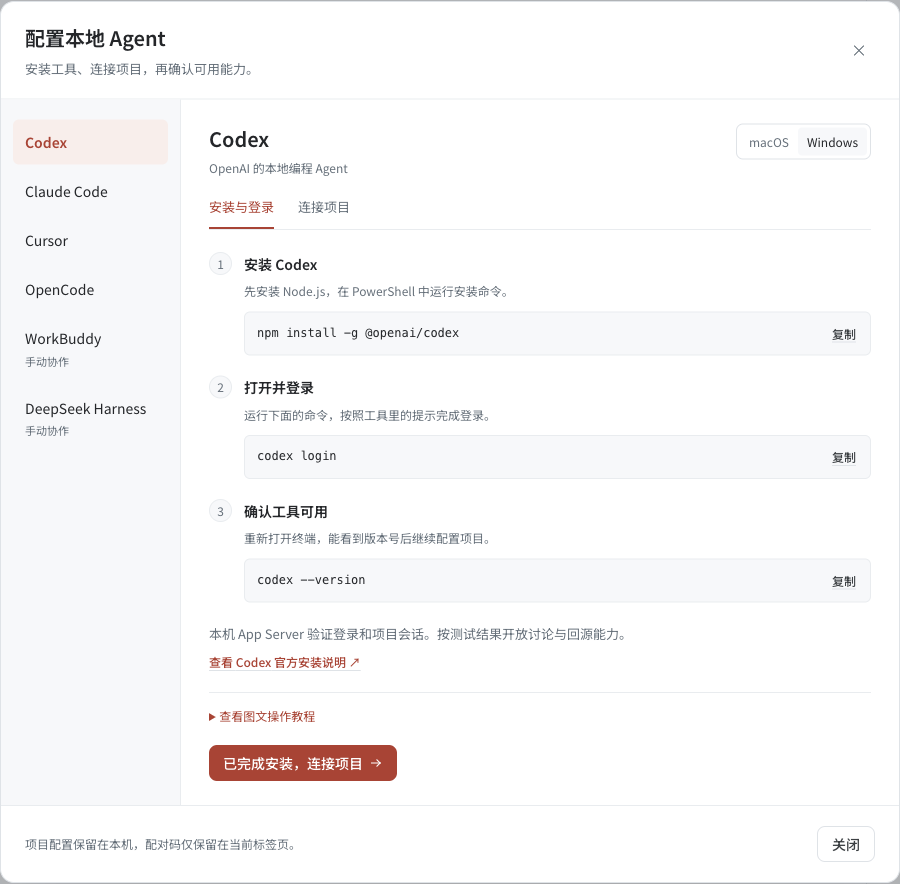
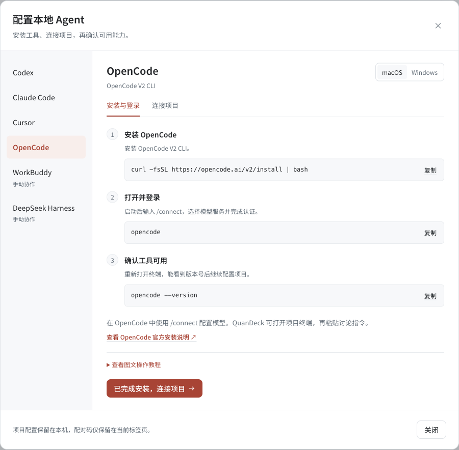
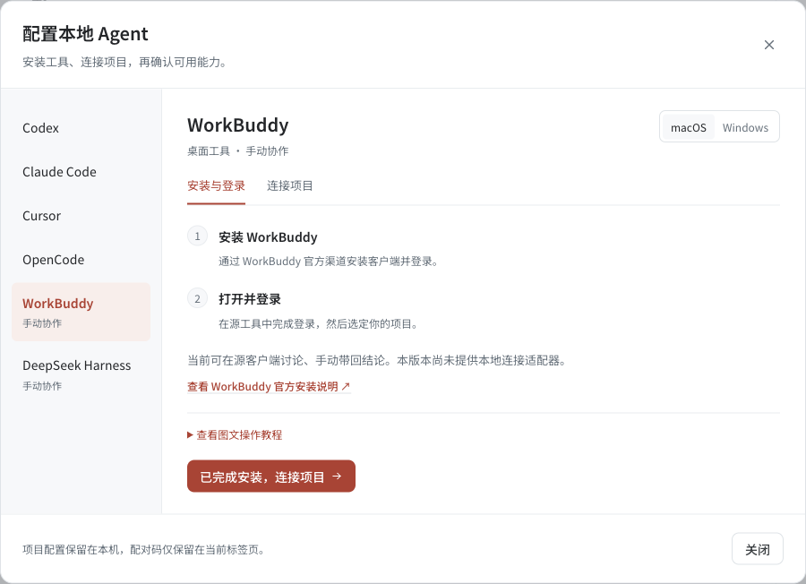
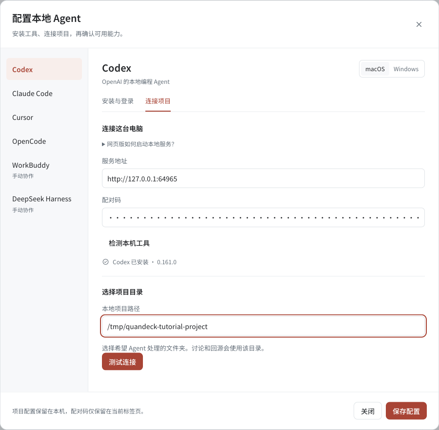
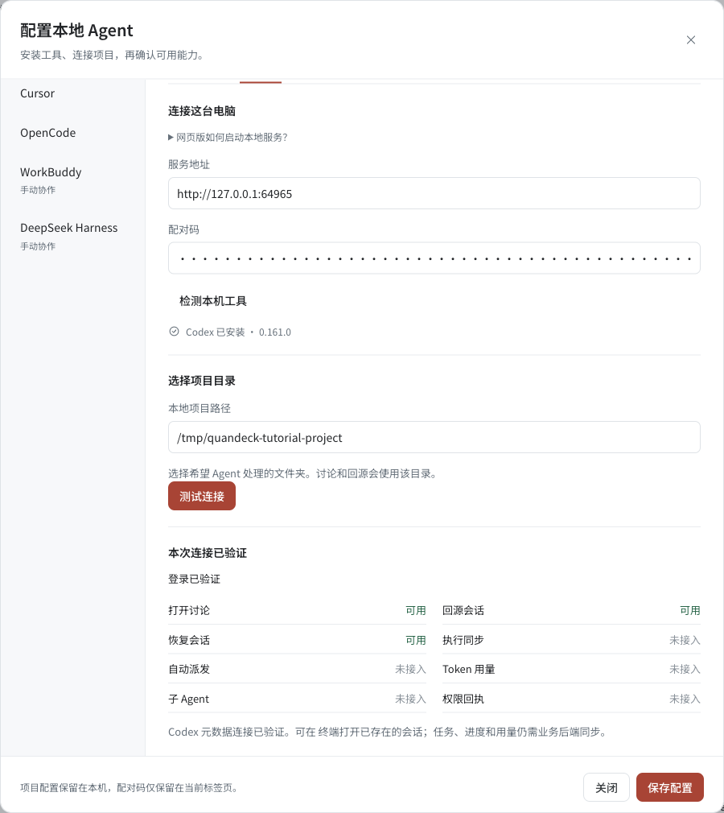

# 本地 Agent 配置教程

在 QuanDeck 的“我的”页面点击“配置 Agent”，或者在任务页底部的 Agent 区域点击“配置”。首次打开时名单为空。保存工具和项目目录后，该工具才会出现在名单中。

本教程截图来自 2026-11-16 实际运行的 QuanDeck 页面。macOS 和 Windows 标签展示各平台的操作说明。工具安装命令来自官方文档，外部工具的 Windows 安装和登录过程尚未在 Windows 设备实测。下面的 Codex 检测结果来自当前 macOS 设备的真实版本和登录元数据读取。

## 1. 选择工具和操作系统

左侧选工具，右上角选择 macOS 或 Windows。按“安装与登录”里的步骤复制命令到对应平台的终端执行。安装完成后重新打开终端，检查能否显示版本号。

## 2. 按工具完成安装与登录

### Codex

先安装 Node.js，再运行 `npm install -g @openai/codex`。运行 `codex login` 完成登录，使用 `codex --version` 确认安装。需要 Windows 沙箱和权限配置时，继续参考官方 Windows 指南。[Codex CLI](https://developers.openai.com/codex/cli/) · [Windows 指南](https://developers.openai.com/codex/windows)

### Claude Code

macOS 运行 `curl -fsSL https://claude.ai/install.sh | bash`。Windows PowerShell 运行 `irm https://claude.ai/install.ps1 | iex`。运行 `claude auth login` 登录，再运行 `claude --version` 检查。当前官方文档支持原生 Windows，Git Bash 为可选项。[官方安装说明](https://code.claude.com/docs/en/setup)

### Cursor Agent

macOS 运行 `curl https://cursor.com/install -fsS | bash`。Windows PowerShell 运行 `irm 'https://cursor.com/install?win32=true' | iex`。随后运行 `agent login` 和 `agent --version`。[官方安装说明](https://cursor.com/docs/cli/installation)

### OpenCode V2

macOS 运行 `curl -fsSL https://opencode.ai/v2/install | bash`。Windows 从官方页面下载适合电脑架构的独立 CLI，解压并加入 PATH。V2 的 Windows 安装不使用包管理器。运行 `opencode` 后输入 `/connect`，选择模型服务并认证，使用 `opencode --version` 检查安装。QuanDeck 打开项目终端后，讨论指令需要粘贴到 OpenCode。[官方文档](https://opencode.ai/docs)

### WorkBuddy

从 WorkBuddy 官方渠道下载安装包，打开客户端并完成浏览器登录。当前可在源客户端沟通，再把结论记录回 QuanDeck。WorkBuddy 会话控制接口尚未验证，配置页面会明确显示“手动协作”。[macOS 安装](https://www.workbuddy.ai/docs/workbuddy/From-Beginner-to-Expert-Guide/Installation-Mac-Guide) · [Windows 安装](https://www.workbuddy.ai/docs/workbuddy/From-Beginner-to-Expert-Guide/Installation-Win-Guide)

### DeepSeek Harness / DSH

按官方项目要求安装 Node.js，在终端运行 `npx @deepseek-ai/dsh web`，然后打开 `http://127.0.0.1:3080`，按页面和项目文档完成模型配置。DSH 目前为开发者预览，QuanDeck 中按手动协作使用。[官方仓库](https://github.com/deepseek-ai/deepseek-harness)

## 3. 连接这台电脑

桌面版会自动启动本地连接服务并管理配对信息。在“连接项目”里点击“检测本机工具”。

网页版需要先在 QuanDeck 源码目录运行 `pnpm bridge`，保持该终端运行，将实际显示的服务地址和本次配对码填入页面。截图使用测试进程分配的临时端口，实际配置以你自己的终端显示为准。

## 4. 选择项目并测试

桌面版点击“选择文件夹”，选中希望 Agent 处理的项目。网页版填写绝对路径，例如 macOS 的 `/Users/你的用户名/Projects/my-app` 或 Windows 的 `C:\Users\你的用户名\Projects\my-app`。

检测到工具后点击“测试连接”。若提示需要登录，回到工具中完成登录后重试。若未检测到工具，重新打开终端检查 PATH 和版本，再点击检测。

## 5. 看清能力并保存

测试结果分别展示打开讨论、回源、自动派发、执行同步、用量和子 Agent 等能力。只有已验证能力显示“可用”。下面截图中 Codex 登录与回源已验证，执行同步等仍显示“未接入”。这次测试没有启动实际推理。

点击“保存配置”，工具和项目目录会出现在 Agent 名单，重启后仍会保留。配对和测试记录只在当前标签页有效，重新打开应用需要再次验证。保存配置本身不会派发任务。

## 6. 从任务发起讨论

输入想法后进入讨论入口，选择已配置工具和项目，再打开本地 Agent 沟通。交互式讨论由源工具承载，执行数据和结论的自动回流仍取决于相应适配器。当前可以手动记录结论并采用到任务方法。

完整官方依据和版本差异见 [连接方法研究记录](agent-official-methods.md)。
