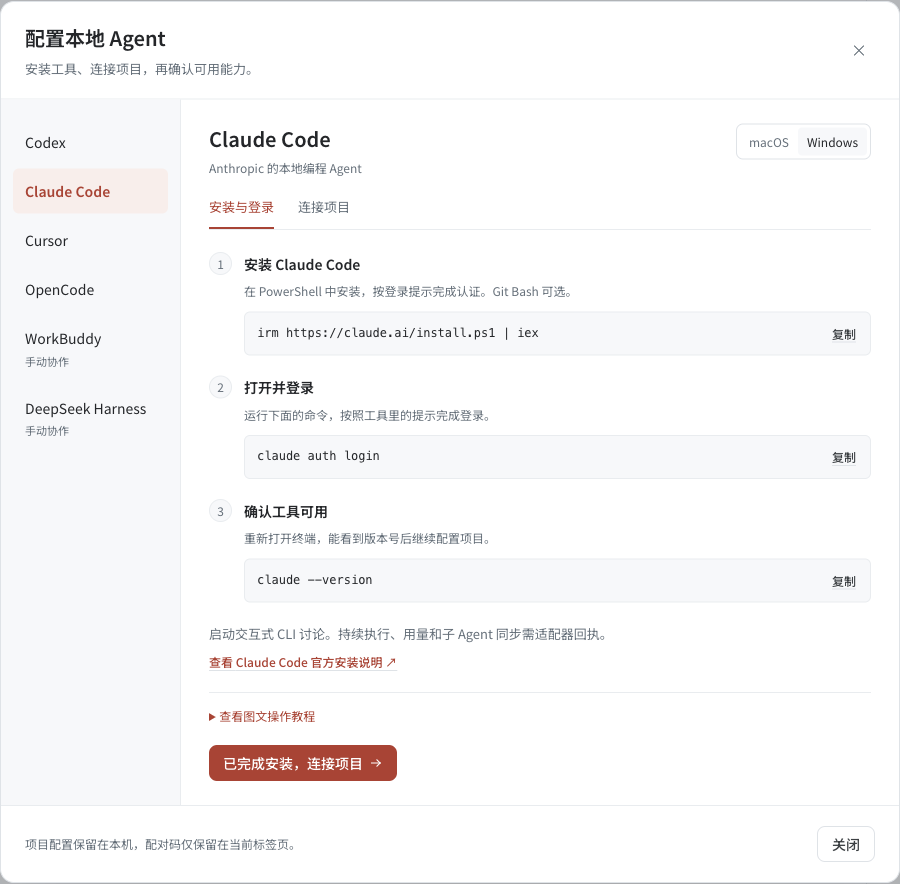
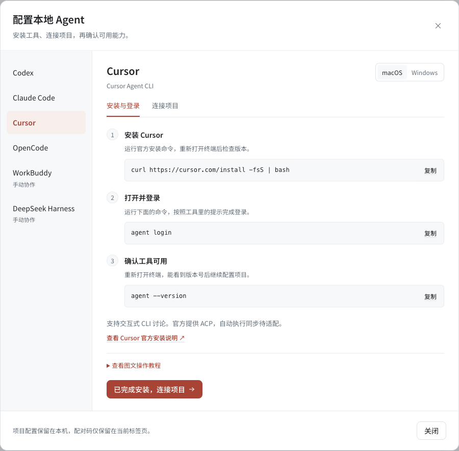
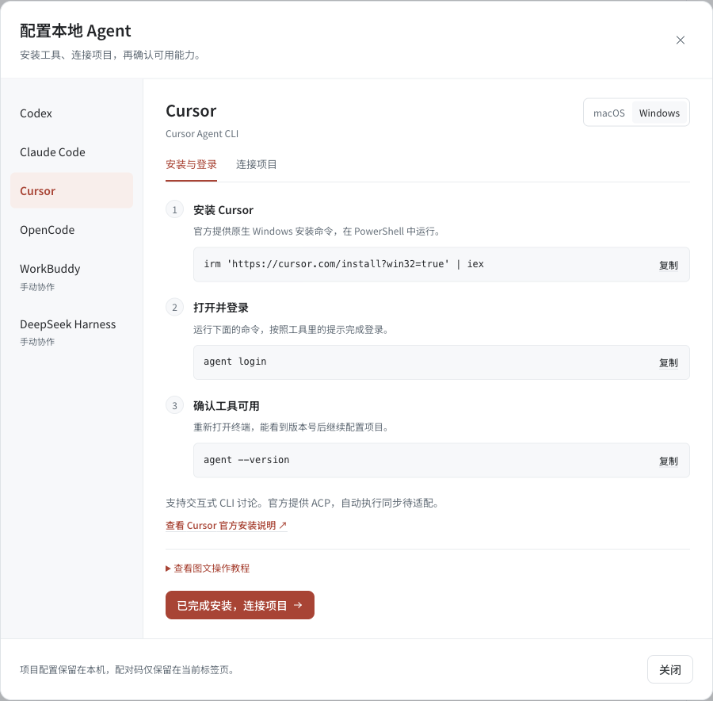
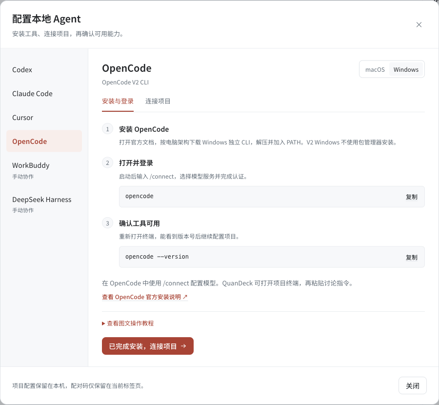
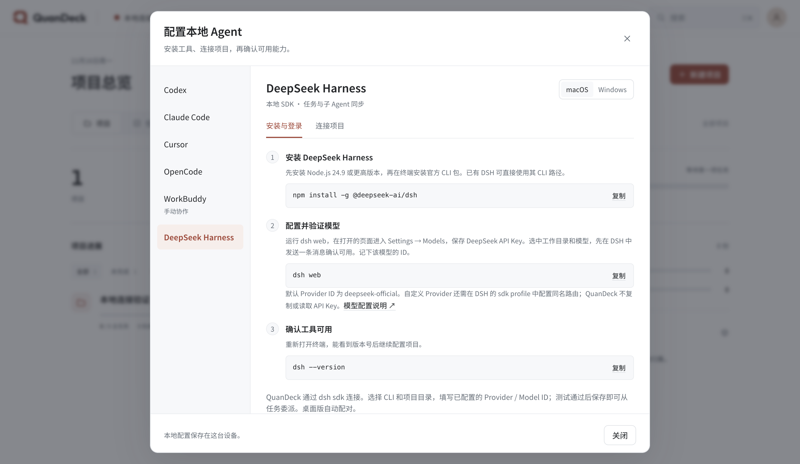
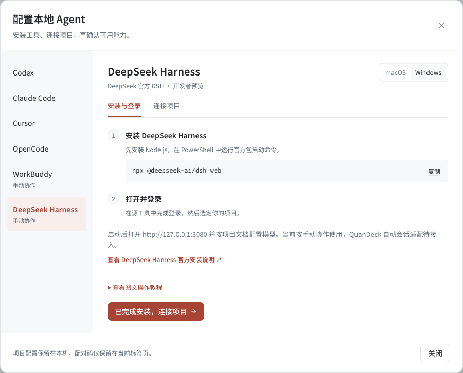
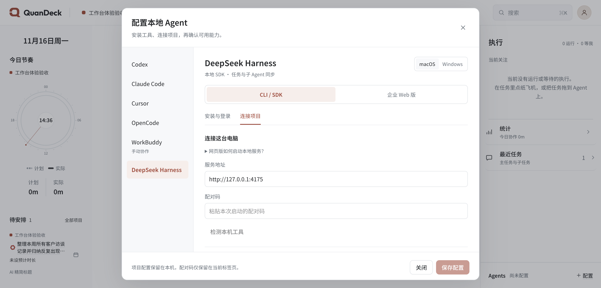
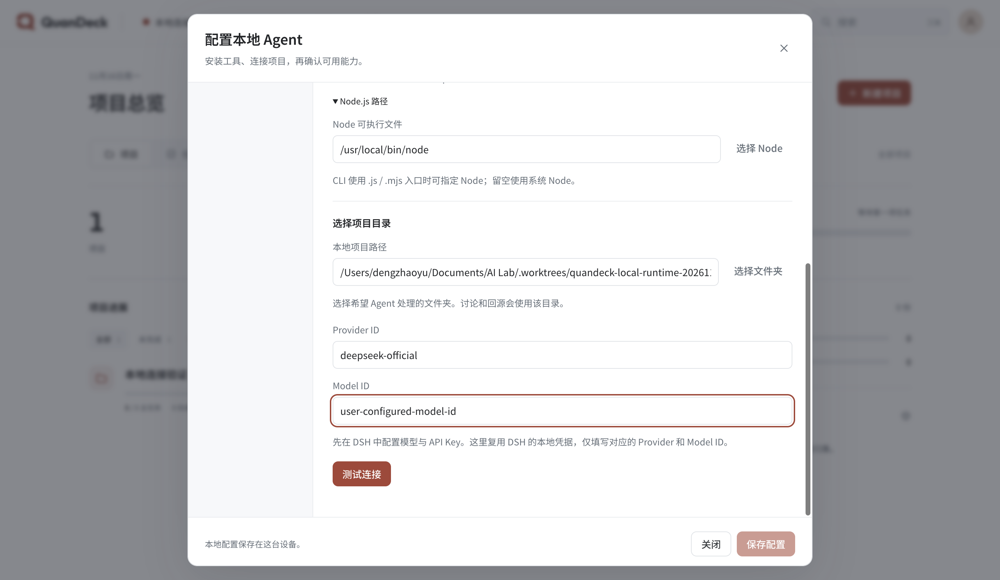

# 本地 Agent 配置教程

点击 QuanDeck 右上角头像，进入“本地 Agent”，点击“配置 Agent”，或者在任务页底部的 Agent 区域点击“配置”。首次打开时名单为空。连接测试成功并保存后，该工具才会出现在名单中。

本教程截图来自 2026-11-16 实际运行的 QuanDeck 页面。macOS 和 Windows 标签展示各平台的操作说明。工具安装命令来自官方文档，外部工具的 Windows 安装和登录过程尚未在 Windows 设备实测。下面的 Codex 检测结果来自当前 macOS 设备的真实版本和登录元数据读取。

## 1. 选择工具和操作系统

左侧选工具，右上角选择 macOS 或 Windows。按“安装与登录”里的步骤复制命令到对应平台的终端执行。安装完成后重新打开终端，检查能否显示版本号。

## 2. 按工具完成安装与登录

### Codex

先安装 Node.js，再运行 `npm install -g @openai/codex`。运行 `codex login` 完成登录，使用 `codex --version` 确认安装。需要 Windows 沙箱和权限配置时，继续参考官方 Windows 指南。[Codex CLI](https://developers.openai.com/codex/cli/) · [Windows 指南](https://developers.openai.com/codex/windows)

### Claude Code

QuanDeck 使用官方 Agent SDK 对已登录 CLI 做真实初始化，并在后台发送 hello、校验回复。测试成功后可以委派、续聊、处理权限，并读取用量、子 Agent 和公开执行回执；无需在 QuanDeck 另填 API Key。自定义安装位置可通过“CLI 路径”选择程序。

macOS 运行 `curl -fsSL https://claude.ai/install.sh | bash`。Windows PowerShell 运行 `irm https://claude.ai/install.ps1 | iex`。运行 `claude auth login` 登录，再运行 `claude --version` 检查。当前官方文档支持原生 Windows，Git Bash 为可选项。[官方安装说明](https://code.claude.com/docs/en/setup)

### Cursor Agent

macOS 运行 `curl https://cursor.com/install -fsS | bash`。Windows PowerShell 运行 `irm 'https://cursor.com/install?win32=true' | iex`。随后运行 `agent login` 和 `agent --version`。[官方安装说明](https://cursor.com/docs/cli/installation)

### OpenCode V2

macOS 运行 `curl -fsSL https://opencode.ai/v2/install | bash`。Windows 从官方页面下载适合电脑架构的独立 CLI，解压并加入 PATH。V2 的 Windows 安装不使用包管理器。运行 `opencode` 后输入 `/connect`，选择模型服务并认证，使用 `opencode --version` 检查安装。QuanDeck 打开项目终端后，讨论指令需要粘贴到 OpenCode。[官方文档](https://opencode.ai/docs)

### WorkBuddy

从 WorkBuddy 官方渠道下载安装包，打开客户端并完成浏览器登录。当前可在源客户端沟通，再把结论记录回 QuanDeck。WorkBuddy 会话控制接口尚未验证，配置页面会明确显示“手动协作”。[macOS 安装](https://www.workbuddy.ai/docs/workbuddy/From-Beginner-to-Expert-Guide/Installation-Mac-Guide) · [Windows 安装](https://www.workbuddy.ai/docs/workbuddy/From-Beginner-to-Expert-Guide/Installation-Win-Guide)

### DeepSeek Harness / DSH

1. 安装 Node.js 24.9 或更高版本。macOS 终端或 Windows PowerShell 运行 `npm install -g @deepseek-ai/dsh`，再运行 `dsh --version`。这是安装官方 npm CLI 包的方式，已安装的 DSH 可复用现有 CLI。[CLI 包与 Node 版本要求](https://github.com/deepseek-ai/deepseek-harness/blob/master/apps/cli/package.json)
2. 运行 `dsh web`，在打开的 DSH 页面进入 **Settings → Models**，保存 DeepSeek API Key。选择工作目录和模型，发送一条消息确认模型正常工作。[模型配置](https://github.com/deepseek-ai/deepseek-harness/blob/master/docs/user/guide/providers.md)
3. 返回 QuanDeck，选择 **DeepSeek Harness → 连接项目**。桌面版自动启动本地服务并配对，无需填配对码、服务端口或 API Key。
4. **CLI 路径**可留空自动检测；检测不到时点击“选择程序”。macOS 选择 `dsh`，Windows 选择 `dsh.cmd`；也支持 npm 包内的 `lib/bin.js`。不要填写 `npx ...` 或整段 shell 命令。使用 JavaScript 入口时，可在“Node.js 路径”指定 `node` / `node.exe`。
5. 选择任务实际操作的项目文件夹。无需填写 Provider 或 Model ID。QuanDeck 从 DSH 的 `sdk` profile 取得默认模型选择，凭据继续由 DSH 保管。自定义模型需在 DSH 的 `sdk` profile 或全局配置中可用；仅在 `web` / `desktop` profile 中修改的默认模型或路由不会自动复制到 `sdk`，请在 DSH 中完成相应配置。[Profile 配置规则](https://github.com/deepseek-ai/deepseek-harness/blob/master/apps/cli/README.md)
6. 点击“测试连接”。QuanDeck 在后台完成 SDK 初始化，再发送一次 hello 并校验回复；成功后显示“已连通”，随后可保存。测试使用独立临时会话，不会创建任务或把测试内容写入业务会话。保存后从任务选择 DeepSeek Harness，可委派任务或先分析。[SDK 协议](https://github.com/deepseek-ai/deepseek-harness/blob/master/packages/sdk/server/README.md)

最后一张为实际连接页面，选择自己的项目目录即可测试；未测试成功时“保存配置”不可用。

### 企业版 xLink DSH 与 PowerShell

Windows 上显示“未连通”时，按[DSH 逐步配置与排查](windows-agent-troubleshooting.md)核对命令入口、SDK 默认模型和失败阶段。

`powershell.exe` / `pwsh.exe` 是执行终端，不是 DSH CLI。检测按钮查找 PATH 和标准安装目录里的实际命令；“未找到 CLI”并不表示企业 Web 客户端未安装。配置窗口现在分别提供 **CLI / SDK** 和 **企业 Web 版**。

用户报告的 xLink DSH 外壳版本为 `0.2.0-rc.2`，本机 GUI 为 `http://127.0.0.1:19387`。这个端口与上游 Desktop 默认端口相同，只能作为定位线索，不能据此确认厂商协议。GUI 地址也不是 QuanDeck 的本地配对服务地址。

如果企业客户端保留 **Manage dsh Command… → Install / Repair**，可以通过它注册终端命令，再重开 QuanDeck 检测。没有该菜单时，向管理员获取实际 CLI / SDK 入口；不要另装官方版本覆盖企业配置。[上游同版本桌面命令说明](https://github.com/deepseek-ai/deepseek-harness/blob/dsh-v0.2.0-rc.2/apps/desktop/README.md#terminal-command)

按顺序操作，每次只做一步：

1. 在 DSH 菜单点 **Manage dsh Command… → Install / Repair**。
2. 从 Windows 开始菜单打开新的 PowerShell，输入 `dsh --version` 确认实际版本。
3. 输入 `where.exe dsh` 查看命令入口。桌面版通常在安装目录的 `resources\runtime\cli\bin\dsh.cmd`。
4. 重开 QuanDeck，选择 **DeepSeek Harness → CLI / SDK → 连接项目**。自动检测或选择上述 `dsh.cmd`。
5. 选择工作文件夹，直接点击“测试连接”后保存。模型和账号继续在 DSH 中管理；QuanDeck 在后台完成实际收发检测，页面只显示是否连通。

用户已在目标机完成前三步，实际命令版本为 `0.2.0-rc.2`，路径属于 xLink DSH Desktop 自带的 CLI 目录。QuanDeck 0.5.3 增加这一入口：严格识别已知桌面启动脚本后，用其自身 Electron/ASAR 运行环境启动 SDK，不需要额外填写 Node；不执行脚本中的任意命令。[上游桌面启动器](https://github.com/deepseek-ai/deepseek-harness/blob/dsh-v0.2.0-rc.2/apps/desktop/cli/dsh.cmd)

rc.2 连接按实际协议开放能力：

| 能力 | rc.2 模式 |
| --- | --- |
| 委派新任务、接收公开输出与用量 | 支持，使用本地已配置模型 |
| 子 Agent 事件 | 接收源端实际事件 |
| 同一存活进程内多轮沟通 | 支持 |
| 暂停/停止 | 结束本次 SDK 进程 |
| 停止、崩溃或重启后恢复旧会话 | 不支持，保留记录并关闭继续入口 |
| 接管已有 Web GUI 会话 | 不支持，不用旧 ID 冒充恢复 |
| 从 QuanDeck 回复权限审批 | 不支持；沿用源端权限，缺少审批响应时操作失败，不自动允许 |

官方 rc.2 SDK 仅提供 initialize、session/prompt、shutdown。未知旧会话 ID 会创建新会话，因此 QuanDeck 不向它发送跨进程恢复请求。SDK 的 serverInfo.version 固定为 0.0.1，不能代替真实 CLI 版本。若 fork 改变协议或模型配置，连接测试会给出实际错误；尚未完成用户目标机器的端到端联调。[rc2 协议](https://github.com/deepseek-ai/deepseek-harness/blob/dsh-v0.2.0-rc.2/packages/sdk/protocol/src/types.ts) · [服务实现](https://github.com/deepseek-ai/deepseek-harness/blob/dsh-v0.2.0-rc.2/packages/sdk/server/src/server.ts) · [源端审批实现](https://github.com/deepseek-ai/deepseek-harness/blob/dsh-v0.2.0-rc.2/packages/interaction/user-approval/src/index.ts)

只提供 Web 接口的版本需管理员提供 API / WebSocket 文档、认证方式和会话定位方式。当前企业 Web 配置页可以整理接入信息、打开 GUI；它不创建连接、不读取浏览器认证、不显示自动同步已启用。

## 3. 连接这台电脑

桌面版会自动启动本地连接服务并管理配对信息。在“连接项目”里点击“检测本机工具”。

网页版需要先在 QuanDeck 源码目录运行 `pnpm bridge`，保持该终端运行，将实际显示的服务地址和本次配对码填入页面。截图使用测试进程分配的临时端口，实际配置以你自己的终端显示为准。

## 4. 选择项目并测试

桌面版点击“选择文件夹”，选中希望 Agent 处理的项目。网页版填写绝对路径，例如 macOS 的 `/Users/你的用户名/Projects/my-app` 或 Windows 的 `C:\Users\你的用户名\Projects\my-app`。

填写项目路径后点击“测试连接”。若提示需要登录，回到工具中完成登录后重试。若未自动检测到工具，可填写或选择 CLI 文件的绝对路径后直接测试。

## 5. 确认连通并保存

后台使用当前 Agent 的账号与默认模型完成一次 hello 收发，页面只显示“已连通”或“未连通”。连接检测不创建任务、不执行项目工具。若检测失败，在源 Agent 检查登录、模型和网络后重试。已保存的 Agent 也可以在设置页重新测试。

点击“保存配置”，工具和项目目录会出现在 Agent 名单，重启后仍会保留。桌面版将连接与项目配置持久化到本地；配对码由应用自动管理。修改 CLI 或项目目录后需要重新测试。DSH SDK 默认模型变更在源工具中完成，新执行会重新读取 SDK 配置；仅修改桌面或网页当前模型不会同步改变 SDK 默认。保存配置本身不会派发任务。

## 6. 从任务发起讨论

输入想法后进入讨论入口，选择已配置工具。Codex、Claude Code 和 DSH 通过本地执行服务承接分析与执行；讨论结论可以采用到任务方法，再拆成任务。

点击“查看源会话”会打开源 Agent。Codex 与 Claude Code 定位到经过校验的原会话；DSH 打开自己的界面，当前 SDK 无法精确跳转到同一会话时会给出简短提示。

完整官方依据和版本差异见 [连接方法研究记录](agent-official-methods.md)。
