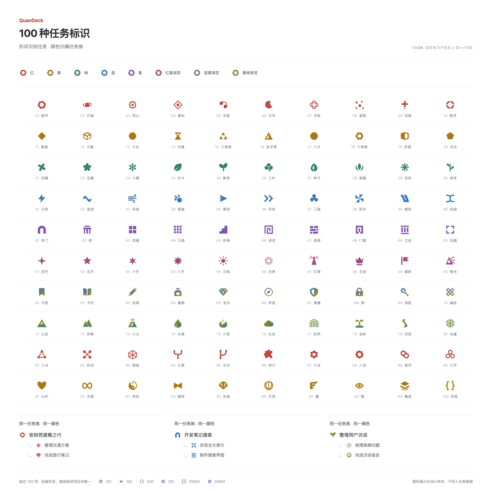

# 任务图标与任务族颜色

同一项目中的主任务和子任务各占一个形状；一个主任务和它的全部后代共用一种任务族颜色。任务形状与 Agent 品牌图标、执行状态标识分别显示，不改变执行状态、权限或任务完成条件。

## 分配与保存

- 形状编号先使用 100 种基础图形，之后采用带外围签名的变体，不循环复用原图形。
- 任务族依次使用红、黄、绿、蓝、紫、红紫渐变、蓝黄渐变、黄绿渐变。不同任务族可以轮用同一颜色；形状仍在项目范围内唯一。
- `Snapshot.taskIdentities` 保存分配表、任务族颜色和单调递增的分配游标。该字段随项目写入桌面磁盘或浏览器存储，也包含在项目导出 JSON 中。
- 改名、排序、完成、归档和重新打开任务不改变分配。删除的记录保留形状占位，避免其他任务冒用曾出现的标识。
- 移动到另一任务族的子任务保留形状，颜色继承新的主任务；旧项目、缺失分配表和重复编号在加载时迁移修复。
- 不同项目独立分配；项目复制可以保留原图标，不会与源项目互相占用。

## 同一身份的多个视图

`getTaskIdentity(snapshot, { taskId, workItemId? })` 为任务列表、树、成果、日程、搜索和执行详情提供相同的 `{ shapeIndex, color, familyId }`。主任务与树中的主任务节点共享一个标识。

源端子 Agent 可以使用 `{ sessionId, subAgentId }`。它已有正式 WorkItem 时共用那个任务的形状；尚无 WorkItem 时只记录图标身份，不生成业务任务或伪造执行记录。形成正式任务后迁移已有形状。

渲染读取不修改快照，不执行存储或分配命令。旧远端快照的纯读取补全按快照缓存。正式分配发生在项目迁移或任务／Runtime 事件的同一原子业务更新中；保存失败时，任务和图标分配一起回滚。

## 验证

`tests/task-identity.test.ts` 覆盖 156 个主／子任务唯一性、8 种任务族颜色、嵌套继承、源记录别名、改名与排序稳定性、跨树同名 ID、换绑、冲突修复、项目隔离、并发新建、存储失败回滚和重启迁移。图形与各页面的实际视觉验收由相应组件检查覆盖。
